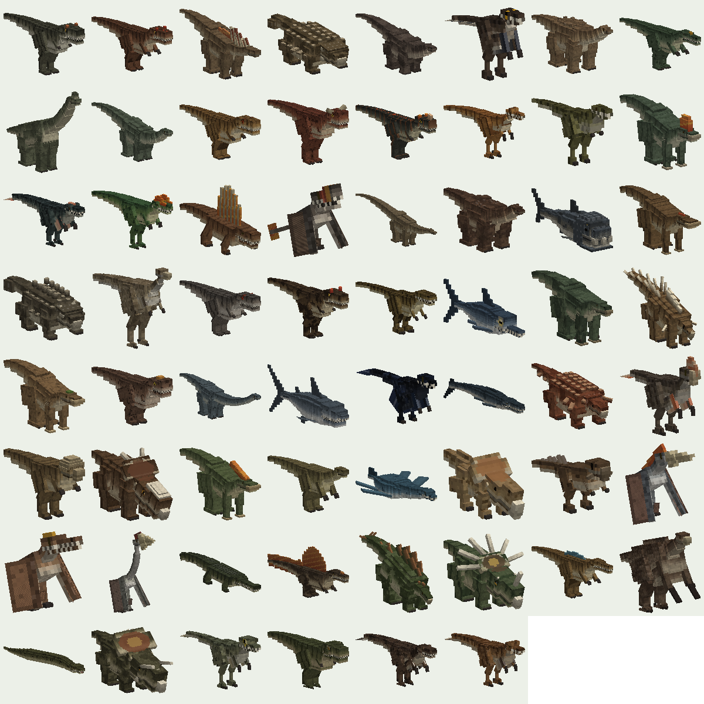

# Prehistoric Dinosaurs

A Minecraft mod for **Bedrock** and **Java** (Fabric) with **50 dinosaurs**, **12 other prehistoric creatures**, ancient plants, a **Prehistoric Jungle** biome, tameable and rideable dinosaurs, **electric fences** and **safari vehicles**. Every model, texture, animation and pack file is generated from code in this repository. One set of definitions drives both editions (see [Java Edition](#java-edition)).

**[Download the latest release](https://github.com/ulfendk/minecraft-dinosaurs/releases/latest)** · **[Creature catalogue (GitHub Pages)](https://ulfendk.github.io/minecraft-dinosaurs/)** · **[Dansk side](https://ulfendk.github.io/minecraft-dinosaurs/da/)**



## Contents

| | |
|---|---|
| **Dinosaurs (50)** | T. rex, Triceratops, Velociraptor, Stegosaurus, Brachiosaurus, Spinosaurus, Ankylosaurus, Diplodocus, Parasaurolophus, Pachycephalosaurus, Allosaurus, Apatosaurus, Brontosaurus, Iguanodon, Carnotaurus, Dilophosaurus, Gallimimus, Compsognathus, Deinonychus, Giganotosaurus, Baryonyx, Therizinosaurus, Utahraptor, Argentinosaurus, Microraptor, Oviraptor, Protoceratops, Styracosaurus, Edmontosaurus, Maiasaura, Corythosaurus, Kentrosaurus, Ceratosaurus, Suchomimus, Carcharodontosaurus, Mamenchisaurus, Amargasaurus, Dreadnoughtus, Coelophysis, Herrerasaurus, Plateosaurus, Psittacosaurus, Euoplocephalus, Nodosaurus, Pachyrhinosaurus, Troodon, Albertosaurus, Gorgosaurus, Majungasaurus, Archaeopteryx |
| **Other prehistoric animals (12)** | Sarcosuchus, Megalodon, Pteranodon, Pterodactylus, Quetzalcoatlus, Dimorphodon, Mosasaurus, Plesiosaurus, Ichthyosaurus, Dunkleosteus, Dimetrodon, Titanoboa |
| **Plants** | Prehistoric fern, horsetail, cycad, club moss, Williamsonia, ancient magnolia |
| **Trees** | Ginkgo biloba, Araucaria (monkey puzzle), dawn redwood, Lepidodendron (scale tree), tree fern. Each has a log, planks, leaves and a sapling, and grows into one of three shapes. |
| **Park gear** | Electric fence + fence generator, safari truck, park tour car, gyrosphere (full-size: seats fit a player), electric prod, tranquilizer rifle + darts |
| **Other** | Fossil blocks, amber ore (with a rare mosquito in amber), dino meat, hide, feathers, scutes, megalodon tooth, creature eggs, and an in-game **Dino Field Guide** |

### Taming and riding

- **Feed to tame:** hold a creature's favourite food: meat for carnivores, ferns, ginkgo nuts or cycad cones for herbivores, and fish for sea creatures and pterosaurs.
- **Egg-only apex predators:** T. rex, Giganotosaurus, Spinosaurus, Carcharodontosaurus and others can only be tamed as hatchlings. Adults sometimes lay eggs. Place an egg and it hatches into a baby that is tame for the player who placed it.
- **Riding:** saddle a tamed adult of a rideable species. Saddles can be crafted from dino hide.
  - Land: T. rex, Triceratops, Stegosaurus, Ankylosaurus, Brachiosaurus (3 seats), Parasaurolophus, Gallimimus and more.
  - Air: Pteranodon, Quetzalcoatlus. Look where you want to fly.
  - Water: Mosasaurus, Plesiosaurus, Ichthyosaurus.

### Ranger gear

- **Electric prod:** hit a creature to shock it. The shock stuns, slows and pushes it back.
- **Tranquilizer rifle:** shoots tranquilizer darts, which are crafted from 4 arrows and a fermented spider eye. One dart knocks out a small animal for 45 seconds. Big herbivores need 3 darts and big carnivores 4. A knocked-out creature lies down.

### Electric fences

Fences connect like vanilla fences and are 1.5 blocks tall, so creatures can't step over them. A **fence generator** touching the fence powers the whole connected network; toggle it by right-clicking or with redstone. Powered fences shock anything that touches them. Big carnivores smash through fences that have no power.

## Install

1. Download `prehistoric-dinosaurs-<version>.mcaddon` from [Releases](https://github.com/ulfendk/minecraft-dinosaurs/releases/latest).
2. Open the file and Minecraft imports both packs. On platforms without file association, unzip it and copy `dinosaurs_BP` → `behavior_packs` and `dinosaurs_RP` → `resource_packs`.
3. In the world settings, activate **Prehistoric Dinosaurs BP**. The resource pack is added automatically.
4. Optional: turn on the **Custom Biomes** experiment to get the Prehistoric Jungle biome. Without it, the ancient plants, trees and creatures appear in vanilla jungle, swamp, savanna, forest, taiga, mesa and ocean biomes.

Requires **Minecraft Bedrock 1.26.40** or newer (Script API `@minecraft/server` 2.9.0).

## Development

```bash
npm ci
npm run schemas     # fetch Mojang's official JSON schemas (bedrock-samples) into .cache/
npm run build       # → build/dinosaurs_BP, build/dinosaurs_RP
npm test            # schema validation + cross-reference tests
npm run package     # → dist/*.mcaddon and *.mcpack
npm run preview     # renders every creature to docs/gallery/*.png (no game needed)
npm run site        # builds the GitHub Pages site into site/
npm run smoke       # loads the packs into a real Bedrock Dedicated Server (Docker)
```

### How it works

```
src/data/creatures/*.ts   one definition per species: anatomy, palette, stats, taming, riding, spawning, field-guide text
src/model/                model builder, parametric rigs (theropod, quadruped, pterosaur, marine, fish, snake), box-UV packer
src/creatures/features.ts horns, frills, crests, sails, plates, clubs, armour, fins …
src/texture/              texture painter: countershading, stripes/spots/mottling, eyes, teeth, scales, plus 16×16 pixel art
src/anim/                 Molang animations: walk, swim, fly, look, attack, sit/lie
src/emit/bedrock/         Bedrock behavior/resource pack emitters (entities, blocks, items, recipes, worldgen, biome)
src/scripts/              Script API: egg hatching, fence power and shocks, sapling growth, leaf decay, field guide
tools/preview/            software renderer used for visual QA, the catalogue and the pack icon
tools/schemas.ts          validates the output against Mojang's schemas and flags unknown keys
tools/bds-smoke.sh        runs the packs in Bedrock Dedicated Server and fails on content-log errors
```

To add a creature, add a `CreatureDef` to one of the files in `src/data/creatures/`, then run `npm run preview -- <id>` and look at the render in `docs/gallery/<id>.png`. The rest of the pipeline (entity behaviour, client entity, geometry, texture, animations, loot, spawn rules, egg, field-guide entry, catalogue card) is generated from that definition.

### Releasing

1. Push a tag: `git tag v0.2.0 && git push origin v0.2.0`.
2. The **Release** workflow tests the code, builds the packs and runs the dedicated-server smoke test. It then publishes a GitHub release with the `.mcaddon` and the `.mcpack` files, and redeploys the **Pages** site with the new version and download link.

One-time setup: in the repository settings, go to **Pages** and set **Source** to **GitHub Actions**.

## Java Edition

A Fabric mod for **Minecraft Java 26.3** is built from the same creature definitions as the Bedrock add-on. It needs:
- [Fabric Loader](https://fabricmc.net/use/)
- [Fabric API](https://modrinth.com/mod/fabric-api)
- [GeckoLib](https://modrinth.com/mod/geckolib) 5.5+

To install it, download `prehistoric-dinosaurs-fabric-<version>.jar` from [Releases](https://github.com/ulfendk/minecraft-dinosaurs/releases/latest) and put it in your `mods` folder.

**What's the same as Bedrock:**
- all 62 creatures with the same models, textures and animations
- taming, sitting and saddles, and riding on land, in the air and underwater
- breeding, egg laying and hatching
- natural spawning
- the items
- plants and trees with world generation
- fossils and amber
- electric fences and the generator
- the electric prod and tranquilizer rifle
- the vehicles
- English and Danish text

**What's different:**
- **No custom biome.** Fabric can't add biomes without extra libraries, so plants and creatures appear in vanilla biomes, as on Bedrock without the experiment.
- **Field guide.** Use it on a creature to show that creature's entry.

**How it's built:** `npm run build:java` writes the generated resources to `java/src/generated/resources`. The Java code in `java/src` is a set of small data-driven classes: one entity class that every creature uses, plus subsystems for blocks, gear and vehicles.

```bash
npm run build:java
cd java
./gradlew build             # → build/libs/prehistoric-dinosaurs-fabric-<version>.jar
bash smoke-server.sh        # Fabric dedicated server: summons every creature
./gradlew runClientGameTest # real game client: screenshots of every creature
```

## License

MIT. This is a fan project and is not affiliated with Mojang Studios or Microsoft. "Minecraft" is a trademark of Mojang Synergies AB.
